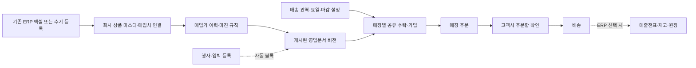
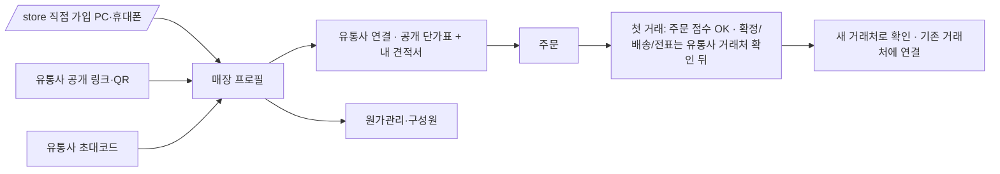
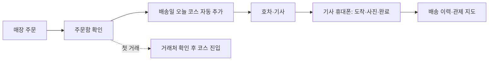

# MAJU 제품 큰틀과 실행 우선순위

> 2026-11-06 · 11/11 23:15 갱신(매장 길·판매 메뉴·공통 화면·분류 체계·영업 대상·TMS 방향) · 상태: 제품 방향 및 작업 순서. 운영 DB 변경, 기능 플래그 활성화, 배포 승인이 아니다.
> 근거: 운영 커밋 `529e8be`, [백엔드 계약](../backend/00_BACKEND_CONTRACT.md), [구현 공백](../backend/04_GAPS.md), [모듈형 모놀리스 작업지시서](../specs/modular-monolith-reorganization-work-orders-2026-11-01.md). 코드·운영 DB·환경 플래그는 작업 시작 때 다시 확인한다.

## 1. 제품 결정

**MAJU는 기존 ERP를 교체하지 않고도 시작할 수 있는 유통업 운영 플랫폼이다.** 첫 구매 이유는 상품·매입가를 올려 판매가를 정하고, 영업문서를 만들어 주문을 받는 시간을 줄이는 것이다. 배송과 ERP는 같은 데이터에 단계적으로 붙는다.

- 약속: **“ERP는 그대로 사용하세요. 매입가와 상품 목록만 올리면 판매가·영업문서·주문 접수부터 시작할 수 있습니다.”**
- 확장 메시지: **“영업부터 주문, 배송, ERP까지. 하나의 MAJU.”**
- 고객사는 `영업·판매`, `주문`, `배송`, `ERP`를 필요한 만큼 켠다. ERP 사용은 주문 링크나 영업문서의 선행 조건이 아니다.
- 하나의 Next.js 배포와 회사별로 격리된 공유 DB를 유지한다. 기능을 켠다고 별도 서비스나 별도 상품·거래처 원장을 복제하지 않는다.
- 구매·판매 가격과 공급처는 회사 내부 데이터다. 매장 공개 응답은 판매가와 주문에 필요한 필드만 보낸다.

### 고객사가 실제로 밟는 길



### 매장이 밟는 길 (2026-11-11 대표 결정)



- 기본 입구는 **`/store` 직접 가입**(PC·휴대폰). 링크·QR·초대코드는 유통사 연결 입구. 유통사 목록·검색은 없다(영업권 보호). 설계: [매장 직접 가입](../design/2026-11-11-store-direct-signup.md).
- PC 매장 화면은 MAJU 운영 틀(`AppSidebar`)을 재사용, 휴대폰은 하단 탭.
- **첫 거래 확인(11/12 운영, CX-13·CC-08)**: 초대코드로 생긴 매장 계정은 "확인 필요"로 시작. 첫 주문 접수는 받고, 주문 확정·배송·전표는 유통사가 주문함에서 [거래처 확인] 하기 전까지 DB가 막는다. 확인은 ① 새 거래처로 확인 ② 기존 거래처에 연결(접수만 된 주문·그 링크를 함께 이동). 후보는 사업자번호·이름+주소로 보여 주기만 하고 자동 병합 없음. 일반 병합은 2차.

### 판매 메뉴 (2026-11-11 결정 → 11/12 가격 관리로 재구성)

`매입가 업로드(제외 코드: 이 매입처만/회사 전체) → 상품관리(분류 폴더·끌기·옮기기·삭제/숨김·행사 배지) → 가격 관리[판매가 | 행사·임박 | 매장 가격] → 견적서·단가표 → 인쇄 기본값`. 지시: [가격 관리 재구성(CC-30)](../dispatch/2026-11-11-pricing-simplify.md) · [단가 구성 표](../design/2026-11-11-pricing-layers.md).

### 가격이 정해지는 순서 (2026-11-12 운영)

```mermaid
flowchart LR
  C[매입가] --> M[판매가 = 직접 단가 > 상품 마진 > 분류 마진(가까운 상위 폴더) > 기본 마진]
  M --> G[등급가(마진 템플릿)]
  G --> SP[매장 가격(매장 개별·견적 수락)]
  SP --> D[견적서: 받는 매장 고르면 매장 가격>등급가>기본가 자동, 줄마다 출처 배지]
  M --> PS[단가표: 등급 하나 선택]
  D --> V[확정 = 가격 고정(스냅샷)]
  PS --> V
  V --> O[매장 주문: 행사 대상이면 행사가 · 아니면 매장 가격>등급가>판매가>문서 줄 — 서버 계산]
  O --> E[매출 전표 단가 = 같은 가격 출처, 0원 경고]
```

- 판매가는 저장 즉시 반영(반영 버튼 없음, 되돌리기 알림). 고정 가격은 매입가가 바뀌어도 그대로라 따로 알려 준다.
- 행사·임박은 기존 상품 코드에 붙이고, 노출 대상은 전체 / 지정 매장·등급만 / 지정 제외(CC-29, 화면 스위치 OFF).
- 가격(계산 기준) · 견적서/단가표(안내) · 주문(요청) · **전표(돈·재고가 움직임)**는 따로 간다. 남은 연결: 매입 전표 확정 → 매입가 자동 기록(E2), 주문 → 매출 전표(E단계).

### 영업 대상과 계정 (2026-11-11 대표 결정)

- **고객사(유통사)의 영업 대상 = 매장**(음식점 등 리드 → 거래처).
- **비브(MAJU 본사, 옛 마주식자재)의 영업 대상 = 유통사**(필요하면 매장도). 유통사 탭·가져오기는 비브만 켠다: [비브 유통사 영업](../dispatch/2026-11-11-vibe-distributor-sales.md).
- 운영 우선순위: **제이에스리테일 운영 최적화 → 다른 고객사 영업**.
- 회사 구분(관리자 화면): `고객사` · `파일럿`(제이에스리테일) · `내부`(비브 — 고객사 지표·결제·알림에서 제외). 같은 시스템을 쓰고 표시·집계만 나눈다(CC-22).
- **영업 문구(11/12, CC-31)**: 리드 대상에 따라 **매장용**·**유통사용** 문구를 따로 쓴다(유통사용은 유통사 영업을 켠 회사만). 종류마다 기본 템플릿 3개 → 회사가 골라 고쳐 저장, MAJU 관리자가 고객사 대신 작성 가능. 변수 `{상호}{회사명}{지역}{업종}{품목}{주력품목}{신규수}`, 값이 빈 변수가 든 줄은 자동 생략. 비브 유통사용 = "신규 오픈 매장을 매일 찾아 드린다"(서비스 판매). 지시: [영업 문구](../dispatch/2026-11-12-outreach-templates.md).
- **유통사 가져오기(11/12)**: 설정 › 영업 정보 › 엑셀 가져오기 — 표준 칸(상호·연락처·주소·등급·상태·ERP·취급 품목 등)은 리드 칸으로, 나머지 칸은 회사 칸(목록 숨김)으로 모두 저장. CSV 한글·칸 이름 줄 선택·중복 의심 묶음·묶음 되돌리기.

### 분류 체계 (2026-11-11 22:00 확정)

대분류 **농산 · 축산 · 수산 · 공산품 · 비식품 · 기타**(이 순서). 공산품 아래 양념·조미료 · 가공식품 · 유제품 · 일배식품 · 냉동식품 · 음료·주류. 폴더 순서는 회사별 `product_category_folders` 한 곳에 저장하고 모든 화면(상품관리·마진·문서·행사·매장 주문)이 같은 정렬 함수로 보여 준다. 지시: [분류 중복 정리](../dispatch/2026-11-11-category-dedupe.md) · [상품관리·매입처/매출처](../dispatch/2026-11-11-products-partners.md).

### 배송(TMS) 방향 (2026-11-11 23:03 대표 결정)



웹을 먼저 최적화한다: 주문 확인 → 오늘 코스 자동 연결, 기사 휴대폰 화면(운행 중 화면 꺼짐 방지, 도착·완료 순간 위치), 관제 지도 실시간 구독. 백그라운드 실시간 위치는 웹으로 불가(브라우저 정책) → 다음 단계에서 공개 위치 앱 수신·차량 단말기·**기사 앱**(안드로이드 먼저) 중 고른다: [방법 기록](../design/2026-11-11-driver-background-gps-options.md). 지시: [D차수 TMS](../dispatch/2026-11-11-D-tms.md).

### 세 화면 공통 기준

고객사·매장·관리자는 같은 공용 부품(탭·제목줄·툴바·공용 표 열 편집)과 글자 기준(12px 이상)을 쓴다: [공통 화면 기준](../dispatch/2026-11-11-UI-consistency.md).

첫 주에 필요한 것은 **A→F가 끊기지 않는 것**이다. G와 H를 기다리게 해서는 안 된다. 다만 주문 시 품목·단위·과세·판매가를 스냅샷으로 남겨 이후 G/H에 같은 주문 ID를 연결한다.

## 2. 서비스 모듈과 사용 모드

| 사용자에게 보이는 영역 | 책임과 첫 출시 범위 | 나중에 확장할 것 | 정본 데이터·소유 도메인 |
| --- | --- | --- | --- |
| 영업 관리 | 리드, 연락·방문, 거래처 전환 | 영업 성과·추천 | `business_permit_leads`, `lead_actions`(lead); `normalized_customers`(customer) |
| 판매 관리 | 상품·매입가 업로드, 분류, 마진(분류별·상품별·**마진 템플릿**), 단가표·견적서, 행사·임박(독립 메뉴, 문서 자동 블록) | 기준 단가 고도화·복잡한 계약 정책 | `product_catalog`/`supplier_products`(catalog), `pricing_*`(pricing) |
| 주문 관리 | 게시 문서 공유, 매장 링크, 주문·내역, 고객사 주문 확인 | 자동 마감·발주·결제 | `storefront_links`, `store_orders`와 줄(order) |
| 물류 관리 | 배송권역, 호차, 코스, 배송 완료 | 주문에서 배차 자동 제안 | customer ID와 배송 계획·완료 기록(delivery/route) |
| ERP 관리 | 선택적 전표·재고·매입·정산 | 출고·입고 자동 연결과 전면 이전 | `business_documents`, `inventory_movements`, `partner_ledger_entries`(각 소유 도메인) |
| 경영 분석 | 영업문서→주문 전환과 배송·매출 요약 | 수익·재고·현금 흐름 | 위 정본의 읽기 집계. 별도 금액 정본을 만들지 않는다 |
| 공통 운영 | 회사 가입·직원 권한·데이터 가져오기·구독 설정 | 플랫폼 운영자 진단과 기능별 사용량 | `companies`, `company_members` 등(organization). 고객사 업무 데이터와 운영자 권한을 분리한다 |

### 빠졌던 두 사용자 영역

| 영역 | 1차에 유지할 것 | 확장할 흐름 | 경계 |
| --- | --- | --- | --- |
| 플랫폼 관리자 | 기존 `/admin`의 고객사·계정·운영 현황을 유지 | 회사가 늘어날 때 플랫폼 표준 품목·별칭·바코드 사전, 회사 품목 연결 큐, 미연결·중복·품질 지표를 한 곳에서 관리 | 회사별 원본 품목명·ERP 코드와 플랫폼 표준 ID를 분리한다. 회사 간 원가 비교·역제안은 종전 결정대로 보류하며 동의·감사·권한 선행 조건 없이 열지 않는다. |
| 매장 주문 링크 → **매장 사이트** | 직접 가입(PC·휴대폰)·카카오 로그인, 연결 유통사별 공개 단가표·내 견적서, 주문·내역, 원가관리(11/11) | 점주·관리자·직원 역할별 주문 권한, 견적서·단가표의 행사·임박 품목 주문, 매장 비용·메뉴 원가, 콘텐츠 초안 | 점주/관리자는 구성원 권한을 관리한다. 매장 비용 자료는 매장 소유 데이터로 고객사 가격 원장과 분리한다. 콘텐츠는 자동 발행보다 작성·검토를 먼저 둔다. |

매장 비용 관리는 매장이 받은 거래처원장·매입가 엑셀을 **필수 열 맞추기 → 미리보기 → 확인 저장**으로 가져오는 흐름이다. 메뉴별 재료·수량·중량·손실률과 단위 환산을 한 번 정하면 원가 관측이 바뀔 때 메뉴 원가를 다시 계산한다. 원본 파일·정정 이력을 보존하고, 유통사에 매장의 다른 매입처 가격을 공개하지 않는다. 블로그·인스타그램·유튜브는 메뉴 사진/영상으로 채널별 **초안**을 만들고 점주 승인을 거쳐 발행하는 후속 모듈이다. 각 채널의 공식 게시 API·권한을 확인하기 전에는 자동 게시를 약속하지 않는다.

기존 `store_accounts`, `store_account_members`, `store_account_member_events`와 카카오 계정 연결을 재사용한다. 매장 역할은 점주·관리자·직원이며 점주가 관리자를 지정하고, 점주/관리자가 직원 권한을 부여한다. 주문은 문서의 상품 스냅샷을 사용하고 주문자 구성원 ID를 남긴다. 이 테이블이 있다는 사실과 초대·권한 변경·주문 전 과정이 운영에서 검증됐다는 사실은 구분한다. 관리자 표준 품목에는 기존 `platform_products` 1단계 설계·연결 큐를 이어 쓰고, 회사 품목을 플랫폼 마스터로 덮어쓰지 않는다.

**도입 모드**는 별도 앱이 아니라 회사별 기능 플래그와 역할로 표현한다.

1. **판매 시작**: 상품·매입가·마진·영업문서. 거래처 전체 이관과 재고 설정 없이 사용 가능.
2. **주문 추가**: 배송 가능 요일·마감·최소금액을 정하고 매장별 링크를 발급. 후결제부터.
3. **물류 추가**: 주문의 배송지·날짜를 권역·호차에 연결하고 완료를 기록.
4. **ERP 추가**: 확정 출고·입고에서 전표, 재고, 원장을 만든다. 기존 ERP와 병행 기간을 허용한다.

화면은 사용 모드에 맞게 숨기되 URL·데이터를 삭제하지 않는다. 숨겨진 기능을 다른 화면의 버튼이나 공개 API가 우회해서 켜지 않도록 페이지와 서버 양쪽에서 같은 회사·역할 플래그를 검사한다.

## 3. 한 번만 결정할 데이터·업무 규칙

| 규칙 | 결정 | 현재 공백/주의 |
| --- | --- | --- |
| 회사와 권한 | 모든 쓰기는 서버가 서명된 세션의 `company_id`·역할을 확정한다. 회사 간 FK는 `(company_id, id)`로 묶는다. | 관리자 미리보기와 공개 링크는 별도 권한 경계다. |
| 상품 | `product_catalog.id`가 회사 상품의 영속 ID다. 매입처의 원본 품목은 `supplier_products`로 남기고 확정 매핑·단위 환산으로 연결한다. | 업로드 오류를 고칠 때 새 상품 중복 생성 여부와 환산 미확인을 구분한다. |
| 상품 코드 | `product_catalog.product_code`의 `P-000001` 형식은 2026-10-15 마이그레이션의 `next_product_code`가 만든 **MAJU 내부 불변 코드**다. 회사가 관리하는 ERP 코드는 별도 선택값이며 누락 시 빈칸이다. | 현재 상품 화면이 내부 `P-`를 “ERP 코드 (자동)”으로 표시하고, 매입가 반영·문서 상품 검색/내보내기에도 같은 값을 섞어 쓴다. 내부 코드를 삭제하면 기존 연결·검색·문서 참조가 흔들리므로 유지한다. 표시/입력과 매칭을 분리하려면 회사 ERP 코드 저장 위치·유일성·업로드 매핑을 먼저 정하고 별도 SQL 승인 후 전환한다. 그전에는 `P-`를 고객사 ERP 코드로 안내하거나 신규 업로드의 누락값을 채워 넣지 않는다. |
| 매입가와 매입 거래 | **판매 관리의 매입가 반영**은 가격 계산용 원가 관측·정정이다. **ERP 매입 관리**는 실제 발주·입고·매입전표다. 같은 상품을 참조하지만 금전·재고 이동은 전표 확정에서만 일어난다. | 매입가 엑셀 업로드만으로 재고나 채무를 만들지 않는다. |
| 판매가 | 직접가·계약가·게시 문서·행사·기본가의 우선순위를 단일 가격 결정 경계에서 해결한다. 마진 재계산은 새 초안/버전에 적용하고 게시본·확정 주문은 바꾸지 않는다. | 계약의 `resolve_price` 단일 경계는 아직 구현 공백(G1). |
| 영업문서 | `pricing_documents`가 작성본, `_versions`가 불변 게시본이다. `sheet`/`quote`는 문서의 거래 목적, 행사·임박은 **문서 줄의 속성**이다. 자유 문서는 필요해질 때 같은 편집기에 표시 규칙만 더한다. | 예전 `sales_quotes`는 당장 이전하지 않고 새 문서와 이름·경로를 구분한다(G6). |
| 공유·수락 | 공개 토큰은 게시 버전과 대상 매장에 연결된다. 수락은 멱등 처리하며 단가표는 문서 연결, 견적은 문서 연결+협의 단가를 만든다. 불명확한 거래처 일치는 확인 대기로 둔다. | 새 영업문서 수락→거래처 연결은 미완성(G6). |
| 주문 | `store_orders`와 줄이 정본이다. 접수 시 품목·규격·단위·세금·판매가를 스냅샷으로 저장한다. 매입가·마진·공급처를 공개 응답에 넣지 않는다. | 고객사 주문 처리·마감, 주문→출고·전표 연결이 미완성(G1/G2). |
| 배송·ERP | 주문이 없어도 기존 거래처 코스는 동작한다. ERP가 켜지면 확정 출고/입고만 전표를 만들고 전표가 재고·원장의 근거다. | TMS와 주문·전표의 연결은 별도 세로 흐름으로 검증한다. |

새 테이블을 제안할 때는 [백엔드 계약 2절](../backend/00_BACKEND_CONTRACT.md)의 정식 이름을 먼저 확인한다. `ledger_entries`, `product_purchase_units`, `company_unit_policies` 같은 중복 원장은 만들지 않는다. 운영 SQL은 별도 승인 표와 `DB-APPROVED` 문구 없이는 실행하지 않는다.

## 4. 현재 위치와 가장 큰 단절

> **2026-11-10 갱신 메모(컨트롤타워)**: 아래 표는 11-06 기준이다. 이후 들어온 것 — 공개 문서 링크·QR, 카카오 점주 가입·개업 준비 매장, 기본주소·상세주소 분리, 주문 전 배송 권역·요일 서버 판정, 마진 설정 재구성(분류별), 매장 카카오 홈(#471). 아직 없는 것 — **고객사 주문함(R1 CC-02)**, 공개 문서로 가입한 매장의 홈 문서 연결(CX-07), 주문→배송·ERP 연결. 최신 상태는 단계 체크리스트 "지금 상태"를 본다.

2026-11-06의 저장소·배포 코드 기준이다. **운영에서 회사별 플래그·실제 주문 처리까지 로그인 E2E로 확인한 결과가 아니다.**

| 고객 동작 | 현재 | 끊기는 곳 |
| --- | --- | --- |
| 엑셀 → 상품·매입가 | 구현·대표 회사 사용 중. 원본 매입 이력·정정 및 상품 연결이 있다. | 기본 매입처·단위·변동 탭 같은 업로드 후 검수 품질을 계속 실데이터로 확인해야 한다. |
| 매입가 → 마진 → 문서 | 가격 재계산과 `sheet`/`quote` 공통 편집기, 행사·임박 줄, 버전, 인쇄/PDF/PNG가 있다. | 가격 결정 경로가 완전히 하나가 아니고, 게시 전후 가격 차이 검증을 한 흐름에서 더 강화해야 한다. |
| 문서 → 공유·수락 | 기존 거래처별 게시 버전 링크와 예전 견적 수락은 있다. | **새 영업문서의 공통 수락·신규 매장 연결이 없다.** 리드에게 보낸 문서에서 첫 주문까지 이어지는 길이 끊긴다. |
| 매장 주문 → 고객사 처리 | 링크 주문·주문 내역·다시 담기가 있다. | 주문 확인·마감·담당자 처리 화면과 배송 배정이 영업문서 흐름에 충분히 붙지 않았다. |
| 배송 → ERP | 지도·코스·배송 기록, 수기 전표·재고 화면이 있다. | 주문 출고 확정→매출전표→재고·원장, 발주·입고의 일관된 연결은 없다. ERP는 기본 보류가 맞다. |
| 첫인상·메뉴 | 회사별 기능 플래그와 오늘·영업·주문·단가·동선·ERP 메뉴가 있다. | 상품관리가 ERP 아래라 판매 시작 고객에게 ERP 도입이 선행처럼 보인다. 주문 관리보다 링크 관리가 먼저 보인다. |
| 플랫폼 관리자·매장 확장 | 고객사 운영 콘솔과 매장 링크가 있다. | 관리자 표준 품목 연결·품질 큐, 매장 구성원 권한, 원장 업로드 기반 메뉴 원가, 콘텐츠 초안은 설계·단계 검증이 필요하다. 구현 여부는 화면/API별로 확인한다. |

## 5. 작업 우선순위 — 고객 가치가 이어지는 순서

| 우선순위 | 완료할 세로 흐름 | 현재 재사용할 것 | 완료 기준 | 의존/승인 |
| --- | --- | --- | --- | --- |
| **P0-1 운영 신뢰** | 대표 회사에서 `엑셀 → 상품 연결 → 매입가 이력/정정 → 마진 재계산 → 문서 게시`를 실제 데이터로 검증하고 누락·중복·단위 오류 수정 | 기존 업로드·매입 이력·P0 가격 계산·문서 버전 | 1개 파일로 신규/기존/가격 인상/인하가 모두 예측대로 나오고 재업로드·복구도 재현 가능. 오류는 행 번호·이유·다음 행동을 보여준다 | 운영 데이터 쓰기 검증은 대표 승인 후. 스키마가 필요하면 초안·승인 분리 |
| **P0-2 첫 주문** | **배송 권역·요일 설정 → 게시 문서 → 매장 공유/수락·가입 → 기존 또는 신규 거래처 연결 → 첫 주문 → 고객사 주문함 확인** | `pricing_documents`, 게시 버전, `storefront_links`, `store_orders`, 고객 마스터, 기존 수락 RPC의 검증 규칙 | 단가표와 견적 각각 모바일 390px/PC에서 열람·수락·주문 성공. 중복 요청 결과 1건, 애매한 매칭은 확인 대기, 원가 비노출 | 문서 수락/협의 단가 SQL·기능 플래그의 적용 상태 확인 후 회사 1곳부터 |
| **P1 주문 운영** | 새 주문 알림·확인·수정·마감, 배송 가능일·마감·최소금액 설정 | 주문 링크, 주문 설정, 오늘 홈 카드 | 고객사 담당자가 새 주문을 놓치지 않고 처리하며 마감 후 품목·가격이 고정된다 | 주문 상태·권한·멱등 경계 로컬 PG 테스트 |
| **P1 메뉴·온보딩** | 첫 사용을 `상품 업로드 → 가격 → 문서 → 링크`로 안내하고 메뉴를 `영업/판매/주문/물류/ERP`로 정리 | 기존 라우트·사이드바·시작 체크리스트 | ERP를 켜지 않은 회사도 상품관리·문서·주문을 찾을 수 있다. 기존 북마크는 유지한다 | 공유 컴포넌트 한 곳 수정, 다른 작업과 메뉴 파일 동시 수정 금지 |
| **P1 상품 코드 분리** | 내부 `P-`를 ERP 코드로 보여 주는 표·편집기·엑셀을 조사하고, 외부 ERP 코드가 없으면 빈칸으로 표시·내보내기 | 내부 `product_code`는 유지, 매입처 `supplier_code`와 원본 파일 코드 재사용 여부 확인 | ERP 코드 없는 업로드 후 고객 화면·내보내기에 `P-`가 없고, 내부 매칭·문서 연결은 유지 | 별도 회사 ERP 코드 칸·인덱스가 필요하면 SQL 초안과 운영 승인 선행 |
| **P2 물류 연결** | 주문 배송지·날짜 → 권역·호차 후보 → 오늘 코스 → 배송 완료 | 고객 마스터, TMS 지도·코스, 배송 이벤트 | 같은 주문 ID로 배정·완료를 추적하고 수동 코스는 계속 쓸 수 있다 | P1 주문 상태 확정 후 |
| **P3 ERP 선택 연결** | 출고 확정→매출전표·재고·원장, 발주→입고→매입전표, 실사·정산 | 기존 전표/재고/RPC | ERP 플래그를 켠 회사만 자동 회계·재고 반영. 정정·취소·재시도 시 합계와 수량 일치 | 별도 SQL 승인·PG 테스트. 돈/결제는 별도 승인 |
| **P4 경영 분석** | 문서 열람→첫 주문→재주문 전환, 매출·배송·수익 지표 | 영업 기록·주문·전표 정본 | 같은 기간/회사 필터에서 화면 수치가 원천 ID로 재계산된다 | P0~P3의 원천 정의 완료 후 |
| **P4 플랫폼·매장 확장** (매장 원가관리 1차는 #471로 앞당겨 진행됨) | 관리자 표준 품목 연결·품질, 매장 구성원 권한·비용/메뉴 원가, 매장 콘텐츠 초안 | 기존 플랫폼 표준 품목 1단계 설계, 링크 주문, 엑셀 열 맞추기 | 회사 간 가격 비노출, 매장 역할별 격리, 업로드 정정·재계산, 채널별 검토 가능한 초안 | 범위별 설계·SQL 승인. 콘텐츠 게시 연동은 공식 API 확인 후 |

**첫 출시 판정선은 P0-1 + P0-2다.** P1 이후를 기다리느라 첫 주문을 늦추지 않는다. 반대로 P0-2의 링크만 보이고 주문을 고객사가 처리할 수 없다면 “완료”로 표시하지 않는다.

## 6. 완성도와 속도를 함께 높이는 작업 방식

1. **한 PR은 한 고객 행동을 끝낸다.** “테이블 추가”, “버튼 추가”만으로 완료하지 않는다. 예: 매입가 업로드 PR에는 매핑→미리보기→저장→이력 확인까지의 검증을 포함한다. 큰 DB 선행 조건은 승인 표와 기능 OFF 경계를 먼저 둔다.
2. **기존 부품을 재사용한다.** 새 영업문서 서비스를 만들지 말고 `pricing_documents` 편집기·미리보기·게시 버전을 확장한다. 새 ERP 상품 원장을 만들지 말고 `product_catalog`를 쓴다. 코드 양을 줄이려고 권한·격리·테스트를 생략하지 않는다.
3. **겹치는 파일에는 소유자 한 명.** catalog/매입가는 상품 담당, 가격·문서는 pricing 담당, 공개 주문은 order 담당, 코스는 TMS 담당. `lib/store.ts`, 메뉴, 공통 문서 모델을 두 작업이 동시에 고치면 먼저 병합한 변경을 기준으로 다시 맞춘다.
4. **수직 슬라이스 2개까지만 동시 진행한다.** P0-1(업로드·가격)과 P0-2(문서·주문)는 분리할 수 있다. 두 흐름이 만나는 가격 결정/상품 스냅샷 계약은 한 번만 정의한다. P2/P3는 설계·PG 검증을 병렬로 하되 운영 기능은 P0 이후에 켠다.
5. **실패를 개발 초기에 보이게 한다.** 합성 회사 2곳(권한·격리), 상품 20개(과세/면세·단위·행사·시세), 기존/신규 매장 각 1곳의 고정 시나리오를 만든다. 단위·PG17·API·PC/390px Playwright가 한 PR의 같은 고객 흐름을 검증한다. 운영 데이터는 테스트 fixture로 복사하지 않는다.
6. **배포 게이트는 동일하다.** SQL 초안·down·PG17 → 명시적 운영 승인 → 객체/RLS 읽기 확인 → 코드 배포(플래그 OFF) → 대표 회사 ON → 스모크 → 다음 회사 확대. 기존 데이터 변경은 대상 건수·백업·롤백을 먼저 보고한다.
7. **진행률은 파일 수가 아니라 결과로 잰다.** `업로드 성공률`, `업로드→게시까지 소요`, `게시 문서→첫 주문 전환`, `주문 확인까지 시간`, `배송 완료율`을 회사별로 본다. 데이터가 없는 지표는 0%로 쓰지 말고 “측정 전”으로 표시한다.

### 공통 완료 기준

- 화면: PC와 390px에서 업로드·편집·공유·주문 버튼이 실제로 동작하고, 빈 상태/오류/권한 안내가 있다.
- 데이터: 회사 격리, 같은 요청 재시도, 가격·과세·단위 스냅샷, 기존 링크·버전 보존을 검증한다.
- 보안: 매장 응답에 매입가·마진·공급처·다른 매장의 주문이 없다.
- 검증: 영향 범위의 단위 테스트·PG17·타입·린트·빌드·브라우저 흐름을 통과한다. 실패나 미검증을 PR에 그대로 적는다.
- 운영: 회사별 플래그·운영 SQL 승인 상태·대표 회사 스모크 결과가 확인돼야 “운영 완료”다.

## 7. 지금 결정하지 않을 것

- ERP 전체 이전 날짜, 다른 유통사와 매장을 연결하는 실제 다중 유통사 기능, 선결제/PG, 2% 수금, 회사 간 원가 비교.
- 기존 `sales_quotes`와 레거시 `sales_transactions`를 일괄 변환하거나 삭제하는 작업. 현재 사용 경로를 유지하고 ID 연결·읽기 구분부터 한다.
- 화면의 색·장식 일괄 개편. 다만 메뉴 위치·표 열·버튼·업로드 입구·모바일 사용성은 기능의 일부로 바로 고친다.

## 8. 다음 작업 착수 순서

1. **P0-1 운영 신뢰 점검표**: 대표 회사 실제 파일 1개로 매입처·단위·변동·신규·정정·복구를 확인하고 남은 결함을 기록한다.
2. **P0-2 연결 계약 확정**: `sheet/quote` 수락, 신규 매장 식별, 협의 단가, 링크 발급, 첫 주문의 상태·권한·멱등을 한 표로 정리한다. 기존 SQL 승인/운영 적용 여부를 읽기 전용으로 대조한다.
3. **첫 주문 E2E**: 동일한 합성 데이터로 PC/390px에서 단가표와 견적 각각 `게시→공유→수락→주문→고객사 확인`을 통과시킨다.
4. **메뉴·시작 안내 조정**: 판매 시작 고객의 상품·매입가·문서·링크가 ERP 메뉴에 가려지지 않게 옮긴다. 라우트는 유지한다.
5. 그다음 P1 주문 운영 → P2 물류 연결 → P3 ERP 선택 연결 → P4 분석 순서로 진행한다.

기존 [모듈형 모놀리스 작업지시서](../specs/modular-monolith-reorganization-work-orders-2026-11-01.md)는 **코드 소유권·경계**에 계속 적용한다. 이 문서는 **고객 가치·출시 우선순위**를 결정한다. 데이터 이름·가격·전표 규칙이 충돌하면 [백엔드 계약](../backend/00_BACKEND_CONTRACT.md)을 기준으로 확인하고, 사용자 결정을 바꾸는 경우에는 계약을 먼저 갱신한다.
